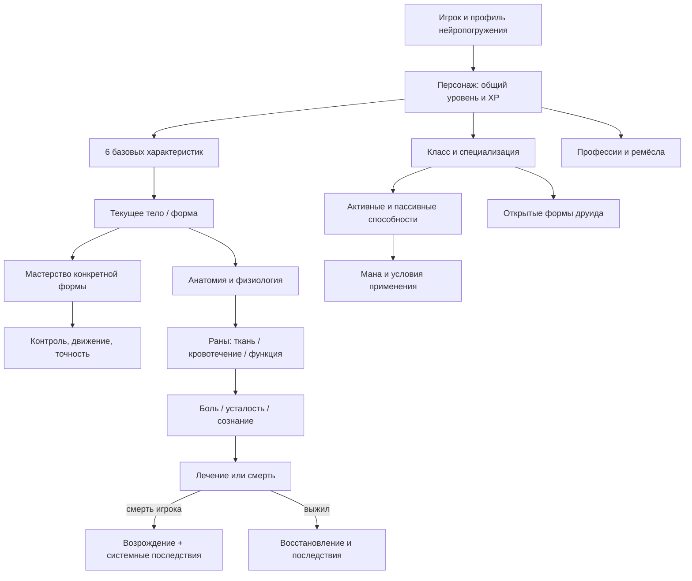

# Архив полного исследования RPG-системы «Эйдоса»

Исходный текст предоставлен автором 20.10.2026. Сохранены все разделы. Внутренние маркеры вида fileciteturn в исследовании относятся к первоначальному экспорту и не являются ссылками GitHub. При конфликте устаревшей v0.2 и исследования автор одобрил исследование.

---

# Глубокое исследование RPG-системы «Эйдоса» для романа «Фон эпоса»

## Резюме

Изначально тема запроса формально была представлена как «неуказанная» и привязана к app-link, однако приложенный мастер-промпт снимает неопределённость: реальная задача — **спроектировать и затем безопасно встроить в существующую рукопись полноценную RPG-систему мира «Эйдос» на диапазон до 100-го уровня**, не разрушив уже написанные 26 глав, авторский канон, механику форм друида, поздние травмы, первую смерть Лира и синхронность TXT/FB2. Предусмотрены четыре последовательных этапа: спецификация RPG-системы, аудит 26 глав, интеграция, затем проверки логики/живости/технической целостности. fileciteturn0file0

Исследование актуального репозитория показывает, что проект уже находится значительно дальше ранних 24-главных редакций. На 20 октября 2026 года ветка `main` дошла до коммита `2b078a944a948040c69154c07363d70d1e0acc20`, посвящённого актуализации RPG-плана для 26 существующих глав. fileciteturn2file0L2-L10 В рукопись уже встроены главы 12 «Осквернённые корни» и 13 «Сердце под корнями»; первая смерть Лира сохранена для поздней части книги, а цепочка опыта после подземелья зафиксирована как `925/1200 → 975/1200 → 1075/1200`, без получения четвёртого уровня. Последний чекпоинт после вставки новых глав фиксировал 380 539 символов TXT и совпадение TXT↔FB2 26/26, но прямо оговаривал отсутствие авторской приёмки новых глав. fileciteturn16file0L2-L2

Главный вывод исследования: **не следует строить новую RPG-систему поверх рукописи как второй независимый слой**. Уже существующая механика достаточно развита, чтобы её эволюционно нормализовать. В тексте уже есть уровни, XP, три полосы интерфейса, характеристики, очки характеристик, мана, выносливость, формы, мастерство формы, навыки, профессии, групповые задания, предметная экономика, смерть и возрождение. Проблема не в отсутствии механики, а в том, что отдельные ранние решения — прежде всего числовое HP, набор `Сила / Ловкость / Выносливость / Интеллект / Дух / Удача` и некоторые слишком «MMO-полосочные» элементы — противоречат позднее согласованному принципу анатомических повреждений без классической модели «минус HP». В рукописи, например, у зайца есть `45/45 здоровья`, у элитного волка — `400/400`, а после удара волка «полоса здоровья обвалилась». fileciteturn15file4 fileciteturn15file5

Оптимальное решение поэтому состоит из пяти связанных реформ.

| Область | Что уже есть | Рекомендуемое решение | Реткон |
|---|---|---|---|
| Уровни и XP | 1→2: 300 XP; 2→3: 600 суммарно; 3→4: 1200 суммарно | Сохранить канонические ранние пороги и продолжить кривую до 100 | Практически нет |
| Характеристики | Сила, Ловкость, Выносливость, Интеллект, Дух, Удача | Сила, Ловкость, Выносливость, Живучесть, Восприятие, Дух | Нужна локальная миграция |
| Повреждения | Есть HP и одновременно подробно описанные реальные травмы | Убрать числовое HP; оставить анатомию, кровотечение, функцию, боль, сознание | Небольшой, но важный |
| Навыки и формы | Хорошая основа: Феллур, мастерство, «Баланс химер», «Мягкая смена» | Отделить общий уровень, навыки, мастерство и физиологию форм | Почти нет |
| Нейропогружение | Сенсорные каналы уже настраиваются | Явно добавить профиль боли и многоканальные предупреждения | Локальное расширение гл. 2–3 |

Такой подход поддерживается и внешними данными. Реальные системы оценки травмы также не сводят повреждение организма к одной «полосе»: AIS классифицирует отдельные анатомические повреждения по локализации и тяжести, а исследования травмы показывают, что даже удобные интегральные показатели вроде shock index недостаточно надёжны в одиночку. Для навыков разумно разделять «уровень персонажа» и практическое владение: метаанализ 54 исследований моторного обучения показывает преимущество вариативной практики для долговременного удержания навыка, хотя сложность задачи существенно модифицирует эффект. Рекомендуемая архитектура в итоге выглядит так:

Ключевой редакторский принцип: **первая книга не должна внезапно демонстрировать всю систему 1–100**. Лир завершает имеющийся материал всего на третьем уровне, с `1075/1200` до четвёртого. fileciteturn15file0 Поэтому ранние 26 глав должны показать лишь фундамент системы; Урсалон, Скайрэйвен, специализации, высокоуровневые ветки и большая часть экономики могут существовать в спецификации, но не обязаны превращать первый том в справочник.

## Цели, допущения и методика

**Исследовательская цель** — определить такую системную архитектуру «Эйдоса», которая одновременно удовлетворяет четырём требованиям: механически интересна на протяжении 100 уровней; объясняет уже существующие сцены; не создаёт ретроспективных «спасительных кнопок» для кульминации; и достаточно проста на поверхности, чтобы LitRPG оставалась романом, а не журналом расчётов.

Мастер-промпт прямо требует не менять сюжетные исходы ради механики, сохранить существующие две главы подземелья, позднюю первую смерть Лира, реалистическую модель повреждений, отдельное развитие форм и навыков и последовательную синхронизацию TXT/FB2. fileciteturn0file0 Это совпадает с текущим рабочим RPG-документом репозитория: в нём утверждены сами принципы, но **численные параметры и конкретные новые способности помечены проектными**, а полная верификация механики, 100-уровневый баланс, построчный аудит и интеграция RPG-реформы ещё не объявлены завершёнными. fileciteturn8file0L2-L2

Методика исследования состояла из четырёх уровней источников.

Во-первых, приоритет отдавался **первичным материалам проекта**: текущей рукописи, глобальному чекпоинту, прямым авторским решениям, RPG-плану, литературному регламенту и техническим отчётам. Это соответствует собственной инструкции проекта, где порядок доверия задан как последнее прямое решение автора → уже написанная рукопись → утверждённый чекпоинт → согласованные концепции → рабочие планы → старые заметки. fileciteturn10file0L2-L2

Во-вторых, проверялось фактическое состояние GitHub, а не исторические данные из старых документов. Это особенно важно потому, что репозиторий за один только 20 октября прошёл переход 24→26 глав, синхронизацию наград подземелья и опыта, правки бытовых сцен и отдельное закрепление новой RPG-архитектуры. Текущая головная ревизия — уже документальный коммит после этих изменений. fileciteturn2file0L2-L10

В-третьих, для реалистичности повреждений, обучения, сенсорного интерфейса и физиологии использовались **первичные/академические источники**, а не игровые вики. AIS выбран только как доказательство полезности анатомически локализованной модели травмы, а не как готовая игровая таблица: сама AAAM подчёркивает, что AIS — лицензируемая, защищённая авторским правом медицинская классификация. Следовательно, для романа следует взять принцип «тип + локализация + тяжесть», но разработать собственную систему, не воспроизводя кодировочный словарь AIS.

В-четвёртых, для пользовательского интерфейса учитывались современные принципы доступности. WCAG 2.2 требует не передавать существенную информацию только через один сенсорный признак вроде цвета, положения или звука; современные игровые платформы также объединяют визуальные, звуковые и тактильные настройки доступности. Для фантастического нейроинтерфейса «Эйдоса» это особенно полезный принцип: отключение боли не должно означать отключение информации о ранении.

Ограничение методики существенно: это **системно-редакторский аудит**, а не медицинская модель организма и не экспериментальный баланс-тест с живыми игроками. Числа ниже являются дизайнерской спецификацией уровня «ПРОЕКТ». Они согласованы с существующими ранними числами рукописи, но до внесения в канон требуют авторского утверждения — ровно как предписывает текущий RPG-документ. fileciteturn8file0L2-L2

## Литература и эмпирические ориентиры

Внешняя литература не даёт готовой формулы для LitRPG, но хорошо определяет границы правдоподобного дизайна.

| Область | Наиболее полезное свидетельство | Значение для «Эйдоса» |
|---|---|---|
| Травмы | AIS описывает повреждения анатомически и оценивает каждое по относительной тяжести 1–6 | Рана должна иметь место, тип и функциональный результат, а не только вычитать HP. |
| Физиология шока | Обзор 111 исследований: для SI>0,9 чувствительность серьёзной травмы лишь ~37%, специфичность ~85% | Нельзя заменять всю физиологию одним «шоком» или одним числом состояния. |
| Интегральные показатели | В исследовании 1435 пациентов AUROC shock index = 0,63, ниже base deficit 0,72 | Состояние должно зависеть от нескольких подсистем. |
| Моторное обучение | Метаанализ 54 исследований обнаружил средний положительный эффект высокой contextual interference на удержание навыков | Мастерство формы разумно повышать через разнообразную практику, а не 500 одинаковых прыжков. |
| Перенос навыка | Отдельный метаанализ сообщил общий эффект на transfer SMD≈0,55 в пользу более переменной практики, хотя applied-эффект был слабее и статистически незначим | Новые ситуации должны давать больше mastery, но без универсального «научился всему». |
| Сложность игры | Эксперимент 2026 года показал наибольший flow при оптимальном соответствии задачи умению; слишком высокая сложность усиливала негативный аффект | Уровень не должен автоматически гарантировать лёгкую победу; важен диапазон осмысленного риска. |
| VR-сложность | В исследовании Beat Saber на 201 участнике соответствие сложности навыку повышало flow, слишком высокая сложность снижала его из-за фрустрации | Поддерживает кривую прогрессии без постоянного power fantasy. |
| Сенсорная безопасность | Систематический обзор VR/AR выявил недостаточно последовательное отслеживание нежелательных эффектов; cybersickness часто недоучитывался | Фантастический имплант должен иметь обязательный safety-layer, а не только пользовательский ползунок. |
| Доступность | W3C запрещает полагаться исключительно на один сенсорный признак | Нулевая боль требует альтернативного визуального/тактильного/проприоцептивного сигнала. |
| Биомеханика | Размер и морфология существенно меняют механику локомоции; крупные животные не являются просто «маленькими × коэффициент» | Формы должны менять массу, момент инерции, устойчивость и манёвренность, а не только статы. |
| Полёт | У птиц скорость связана с массой и нагрузкой на крыло, но морфология и эволюционная группа объясняют существенную дополнительную вариацию | Скайрэйвену нужен собственный профиль полёта; нельзя свести его к `Ловкость +30%`. |

Из этой литературы следуют три важных дизайнерских вывода.

Первый: **реализм не означает вывалить на читателя симулятор реанимации**. Медицинская литература скорее показывает обратное: состояние организма многомерно и плохо описывается единственной простой метрикой. Значит, сложность должна находиться внутри движка, а игроку показываться через понятные последствия: «левая кисть — глубокий ожог; хват ослаблен», «кровотечение усиливается», «опора на правую ногу нестабильна».

Второй: **мастерство формы должно быть процедурным знанием**, а не ещё одним уровнем персонажа. Исследования моторного обучения показывают, что долгосрочное владение связано с характером и вариативностью практики, причём слишком высокая сложность может ухудшать обучение. Это отлично соответствует уже написанным сценам, где Лир сначала буквально учится стоять в чужом теле, а временный полёт Скайрэйвеном требует работы с крылом, воздушным потоком и балансом. fileciteturn15file2 fileciteturn15file3

Третий: **прогрессия должна расширять пространство решений, а не только увеличивать числа**. Экспериментальные исследования flow не подтверждают примитивное правило «чем труднее, тем интереснее»; важнее осмысленное соответствие возможностей и задачи. Для трилогии это означает, что 80-й уровень должен отличаться от 20-го не только большим уроном, но новыми типами взаимодействия с миром, формами, ресурсами и командой.

## Текущее состояние проекта и конфликтная карта

В нынешней рукописи уже существует почти весь каркас LitRPG, поэтому говорить о «создании системы с нуля» методологически неверно.

Начальное меню показывает **здоровье, ману и выносливость**, а форма Феллур имеет собственную карточку. fileciteturn15file1 Затем Лир получает «Чувство природы» за 50 XP, «Росток жизни» за 100 XP; последний стоит 10 маны и ускоряет рост растения на 50%. После первого большого упражнения с Феллур он получает ещё 150 XP, +5% к мастерству формы (`1,00 → 1,05`), второй уровень и три очка характеристик. После «Поляны Света» — ещё 150 XP и «Баланс химер», снижающий расход маны на смену формы на 30%. fileciteturn15file2 fileciteturn15file5 fileciteturn15file6

Далее открываются профессии «Травник» и «Алхимик», групповой бой с элитным волком приводит Лира к третьему уровню, а характеристики меняются с:

`Сила 8 / Ловкость 12 / Выносливость 10 / Интеллект 14 / Дух 15 / Удача 9`

на

`Сила 8 / Ловкость 14 / Выносливость 10 / Интеллект 14 / Дух 16 / Удача 9`.

Иными словами, три очка третьего уровня уже фактически распределены как `+2 Ловкость / +1 Дух`; эту инвестицию нельзя потерять при миграции системы. fileciteturn15file0 fileciteturn15file1

Самое серьёзное противоречие — **HP**. Ранний интерфейс и некоторые бои устроены как классическая RPG: у противников числовое здоровье, у Лира падает полоса здоровья. fileciteturn15file4 fileciteturn15file5 Поздняя проза, напротив, уже фактически работает по новой модели: ожоги ладоней мешают пользоваться руками, у Кайра повреждена рука, раны требуют перевязки, мокрые повязки имеют значение, ранение меняет способность нести груз, а смерть Лира происходит вследствие конкретного физического события, после чего он возрождается с новым телом, но с сильной психологической реакцией. fileciteturn5file0L7-L13 fileciteturn15file0

Таким образом, **поздняя половина романа уже ближе к целевой системе, чем ранняя**. Правильная интеграция должна подтянуть главы 3–13 к тому, как фактически работают последствия в главах 20–26, а не переписывать финал под старые HP.

Вторая конфликтная зона — характеристики. Согласованный RPG-проект предлагает шесть других функций: Сила, Ловкость, Выносливость, Живучесть, Восприятие, Дух; при этом человеческий интеллект не должен автоматически повышаться из-за распределения очков. fileciteturn8file0L2-L2 Это концептуально сильнее нынешних `Интеллект` и `Удача`: «Интеллект +1» плохо сочетается с реалистическим Никитой, а «Удача» создаёт трудно контролируемое объяснение случайностей.

Третья зона — безопасность полного погружения. В главе 2 уже показано, что после обновления импланта Никита регулирует сенсорную чувствительность и выбирает сбалансированный профиль; новый модуль фильтрует и перераспределяет входящие сигналы. fileciteturn15file0 Это означает, что будущий ползунок боли не выглядит внезапным ретконом: он может быть ещё одним уже существующим сенсорным каналом.

Четвёртая — технический контроль. Старый 24-главный цикл действительно был проверен XMLSchema FictionBook 2.1 и дал 0 XSD-ошибок; в документе также зафиксировано 24/24 нормализованных совпадения TXT↔FB2. fileciteturn14file0L2-L6 Но две новые главы были добавлены **после** этого исторического контрольного состояния. Актуальный 26-главный чекпоинт подтверждает 26/26 текстовое совпадение, но не следует автоматически переносить на него старое заявление о XSD-проверке. fileciteturn16file0L2-L2 Поэтому после RPG-интеграции нужен новый XSD-прогон именно текущего 26-главного FB2.

Наконец, литературная рамка накладывает полезное ограничение на дизайн: регламент прямо запрещает превращать роман в процедурный отчёт, одинаковые остроумные голоса и псевдофилософию; интерфейсные сообщения нужны только тогда, когда они меняют решение или понимание героя. fileciteturn9file0L2-L2 Это означает, что хороший 100-уровневый дизайн может быть очень подробным **в спецификации** и очень экономным **на странице романа**.

## Проект RPG-системы «Эйдоса»

Ниже — конкретная рабочая спецификация. Все новые числа помечаются как **ПРОЕКТ**, а уже присутствующие в рукописи ранние числа — как **КАНОН РУКОПИСИ**.

**Общий уровень.** Существующие пороги следует сохранить без изменений:

| Переход | Требуется XP за этап | Суммарный XP | Статус |
|---|---:|---:|---|
| 1 → 2 | 300 | 300 | КАНОН |
| 2 → 3 | 300 | 600 | КАНОН |
| 3 → 4 | 600 | 1200 | КАНОН |
| 4 → 5 | 675 | 1875 | ПРОЕКТ |
| 5 → 6 | 800 | 2675 | ПРОЕКТ |
| 10 → 11 | 2000 | 10 025 после получения 11-го | ПРОЕКТ |
| 20 → 21 | 5850 | 49 825 | ПРОЕКТ |
| 50 → 51 | 24 775 | 495 975 | ПРОЕКТ |
| 90 → 91 | 61 450 | 2 202 075 | ПРОЕКТ |
| 99 → 100 | 71 150 | **2 803 300** | ПРОЕКТ |

Для уровней `L ≥ 3` подходит простая кривая:

\[
XP_{L\to L+1}
=
25 \times round\left(
\frac{600 + 75(L-3)^{1.5}}{25}
\right)
\]

Она специально выбрана так, чтобы дать **ровно 600 XP для перехода 3→4**, то есть не ломать уже существующий порог 1200. Никакого требования, что Лир должен дойти до 100-го уровня в трилогии, нет; это также прямо зафиксировано рабочим RPG-планом. fileciteturn8file0L2-L2

По диапазонам прогрессия выглядит так:

| Диапазон | Роль в развитии |
|---|---|
| 1–10 | Освоение тела, базовых ресурсов, класса и мира |
| 11–20 | Формирование собственного стиля; подготовка специализации |
| 21–30 | Первая глубокая специализация; к ~30 — Урсалон |
| 31–40 | Комбинации способностей, контрмеры и командные роли |
| 41–50 | Высокое мастерство; к ~50 — Скайрэйвен |
| 51–60 | Сложные ресурсные решения и межклассовые связки |
| 61–70 | Модификация базовых способностей вместо их простой замены |
| 71–80 | Стратегическое влияние на большие столкновения и территории |
| 81–90 | Редкие техники с сильными условиями и ценой |
| 91–100 | Капстоуны идентичности класса, но не бессмертие |

**Начисление XP.** Убийства не должны быть главным генератором опыта. Более устойчивый принцип:

\[
XP = B \times D \times N \times C
\]

где `B` — базовая ценность события; `D` — реальный риск/сложность; `N` — новизна; `C` — вклад игрока. Тривиальное повторение постепенно снижает `N`, но исцеление, разведка, переговоры, спасение, ремесло и удержание позиции считаются полноценным вкладом. Это предотвращает ситуацию, где лекарь отстаёт от убийцы только потому, что не нанёс последний удар.

Настройка боли **никогда** не входит в формулу XP. За 100% боли нет бонуса, за 0% нет штрафа. Это одновременно соответствует авторскому решению и предотвращает превращение самопричинённого дискомфорта в мету. fileciteturn8file0L2-L2

**Шесть характеристик.**

| Характеристика | Что определяет | Чего не делает |
|---|---|---|
| Сила | усилие, толчок, тягу, перенос массы | не отменяет ограничения суставов и формы |
| Ловкость | координацию, точность, смену опоры | не даёт сверхсенсорное восприятие |
| Выносливость | объём длительной работы, усталость, восстановление | не делает ткани неразрушимыми |
| Живучесть | физиологический резерв, перенос кровопотери, восстановление | не превращается в броню |
| Восприятие | качество обнаружения и обработки доступных сигналов | не создаёт информацию из ничего |
| Дух | ману, устойчивость и точность магического контроля | не является «силой воли вообще» |

`Интеллект` как числовой атрибут удаляется: знания Никиты, Феррона, лекарей и специалистов остаются знаниями, опытом и навыками. `Удача` тоже удаляется из базовых характеристик; редкость находок определяется миром, профессией, Восприятием там, где это логично, и конкретными модификаторами.

Чтобы не потерять уже распределённые очки, **+2 Ловкости и +1 Духа остаются безусловно**. Миграция старых `Интеллект 14` и `Удача 9` в Живучесть/Восприятие должна быть отдельным авторским решением. Как чисто математический вариант, сохраняющий исходную сумму 68, можно протестировать:

`8 / 12 / 10 / 10 / 13 / 15`

то есть `Сила 8 / Ловкость 12 / Выносливость 10 / Живучесть 10 / Восприятие 13 / Дух 15`.

После уже совершённого распределения третьего уровня это станет:

`8 / 14 / 10 / 10 / 13 / 16`.

Это **не канон**, а наиболее малоболезненная миграционная гипотеза.

Чтобы 297 потенциальных очков за уровни 2–100 не превратили героя в линейно растущего полубога, предлагается diminishing returns:

\[
E(S)=
\begin{cases}
S, & S\le20\\
20+0.65(S-20), & 20<S\le40\\
33+0.40(S-40), & S>40
\end{cases}
\]

Игрок по-прежнему видит и распределяет сырое значение `S`; в физические расчёты идёт эффективное `E(S)`. Тем самым специализация остаётся полезной, но одна характеристика не может бесконечно обгонять анатомию.

**Навыки и мастерство.** Умение и владение — разные сущности. «Росток жизни, уровень 1» означает набор доступных правил способности; практическая способность быстро и точно применять её растёт отдельным мастерством. Для формы это уже фактически есть: Феллур получает +5% mastery после практики. fileciteturn15file5

Рабочая формула прироста мастерства:

\[
\Delta M =
q \times N \times D \times F
\times (1-M/100)^{1.5}
\]

где `N` — новизна упражнения, `D` — уместная сложность, `F` — качество обратной связи/наставничества. Повтор 200 одинаковых прыжков быстро перестаёт давать значимый результат; применение навыка в новой среде или работа с наставником снова ускоряет рост. Это согласуется с данными об эффективности вариативной практики для удержания и переноса моторных навыков, но не утверждает, что случайная вариативность полезна при любой сложности. **Формы.** Сила формы не должна происходить от отдельного второго «уровня персонажа». Рабочая формула:

\[
Physical_{form}
=
E(S)\times A_{form}\times C(M)
\]

где `Aform` — анатомический коэффициент тела, а

\[
C(M)=0.75+0.25\sqrt{M/100}
\]

отражает способность использовать тело. Мастерство не отращивает лишние мышцы; оно уменьшает потери от неумелого управления.

Предварительные коэффициенты — только балансировочные ориентиры:

| Форма | Сила | Ловкость | Выносливость | Живучесть | Восприятие | Главное ограничение |
|---|---:|---:|---:|---:|---:|---|
| человек | 1,00 | 1,00 | 1,00 | 1,00 | 1,00 | универсальность, обычная анатомия |
| Феллур | 1,05 | 1,20 | 1,10 | 1,00 | 1,15 | слабая тонкая манипуляция, иная опора |
| Урсалон | 1,65 | 0,75 | 1,25 | 1,35 | 0,90 | масса, инерция, тесные пространства |
| Скайрэйвен | 0,70 | 1,25 | 0,90 | 0,75 | 1,30 | крыло критично для полёта, ветер, нагрузка |
| Миролур | не определять | не определять | не определять | не определять | не определять | открыть после канонического задания |

Это лучше отражает биомеханику, чем одинаковая прибавка «+30% ко всему»: реальные различия массы и морфологии меняют не только максимальную силу, но управление, инерцию, скорость сенсомоторной петли и локомоторную механику. **Раны вместо HP.** Внутри движка каждая форма получает анатомические зоны и функциональные слои:

`кожа/покров → мягкие ткани → сосуды → кости/суставы → нервы → органы`.

У повреждения есть минимум семь параметров: локализация, тип, глубина/ткань, кровотечение, потеря функции, боль и загрязнение/магический эффект. Общая жизнеспособность вычисляется из дыхания, перфузии, сознания и критических органов, но не показывается как `742/900 HP`. Такой подход ближе к анатомической логике травмы; медицинская AIS также начинает с конкретного повреждения и региона тела, а не с глобального «здоровья». Игрок видит:

> **Состояние:** тяжёлое  
> Правая кисть: глубокий ожог, хват существенно ослаблен  
> Кровотечение: нет  
> Левая нога: без повреждений  
> Дыхание: устойчивое  
> Утомление: высокое

Враг больше не показывает `400/400`, а, например:

> **Лунный волк, элитный, уровень 8**  
> Состояние: без видимых повреждений  
> Опасность: высокая  
> Особенности: лунный рык, быстрый рывок  
> Наблюдаемая уязвимость: свет

Это требует поправить несколько ранних интерфейсных строк, но почти не затрагивает хореографию боёв.

**Живучесть** не уменьшает «урон на 1% за очко». Она влияет на физиологические резервы и скорость стабилизации. Кинжал в незащищённую жизненно важную область по-прежнему способен убить высокоуровневого персонажа. Именно такой инвариант уже заложен в текущем RPG-плане. fileciteturn8file0L2-L2

**Мана и выносливость** могут оставаться числовыми, поскольку они являются расходными ресурсами, а не симуляцией конкретной ткани. Как рабочий баланс:

\[
Mana_{max}=50+5E(Дух)
\]

\[
Stamina_{max}=60+4E(Выносливость)
\]

При стартовых значениях Лир имел бы около 125 маны и 100 выносливости. Уже существующие 10 маны за «Росток жизни» тогда означают заметный, но не огромный ранний расход. Это проектная калибровка, а не новая реплика, которую обязательно надо вставлять в книгу.

**Лечение** должно воздействовать на конкретные процессы. Базовый лекарь может остановить умеренное кровотечение, уменьшить отёк, очистить рану, временно поддержать функцию; он не обязан за секунду восстановить разорванное сухожилие. Именно поэтому уже написанная фраза Тарина о том, что он «жрец первого уровня подготовки», а не чудотворец, отлично соответствует будущей системе. fileciteturn15file9

**Боль и нейропогружение.** Рекомендуемый пользовательский диапазон — `0–100%`, но это **масштаб субъективного сигнала**, не тяжести травмы. При 0% система обязана компенсировать потерю предупреждающей функции: цветной картой тела, изменением проприоцепции, кратким тактильным импульсом и текстовым статусом. Существенную информацию нельзя оставлять в одном сенсорном канале — это соответствует современному принципу доступности W3C. При 100% пользователь всё равно не получает право снять аппаратные safety-limits. Современная VR уже демонстрирует нежелательные эффекты вроде cybersickness, дезориентации и нарушения постуральной стабильности; фантастическая система прямой нейростимуляции тем более правдоподобно должна иметь независимый контур защиты. Трансформации лучше по умолчанию передавать как давление, смещение центра тяжести, изменение схемы тела и проприоцепции, а не как обязательную мучительную боль. Это делает сцену телесной и не превращает погружение в систему вознаграждения за страдание.

**Друидская прогрессия.** Уже канонические/фактически присутствующие основы следует оставить: «Чувство природы», «Росток жизни», Феллур, «Баланс химер», «Мягкая смена», профессии травника/алхимика. fileciteturn15file2 fileciteturn15file0

Дальнейшая ветка может выглядеть так:

| Уровень | Проектный рубеж друида | Ограничитель |
|---:|---|---|
| 5 | улучшение «Чувства природы» | не определяет вид/намерение автоматически |
| 7 | «Корневая опора» | требует живой растительности |
| 10 | первая развилка улучшения базовой формы | выбор, а не бесплатное всё |
| 12 | успокоение обычного животного | не контроль разума; плохо работает в бою |
| 15 | ограниченная природная стабилизация раны | не лечит перелом/орган мгновенно |
| 20 | специализация | выбрать одно главное направление |
| 25 | адаптация к среде | требует времени/подготовки |
| ~30 | постоянное открытие Урсалона | отдельное испытание + новое mastery |
| 40 | углубление специализации | взаимоисключающие сильные улучшения |
| ~50 | постоянное открытие Скайрэйвена | отдельное освоение полёта |
| 60 | продвинутая синергия формы и природной магии | высокая цена ошибки |
| 70 | классовый capstone средней ступени | не отменяет анатомию |
| 80 | стратегическая природная способность | зависит от среды |
| 90 | высшее направление специализации | длинные условия/цена |
| 100 | финальный классовый выбор | не абсолютная неуязвимость |

Три специализации дают достаточно различий без десятков несвязанных веток: **Хранитель рощи** — защита, стабилизация, контроль пространства; **Следопыт облика** — формы, чувства, движение и адаптация тела; **Проводник живого** — растения, алхимия, взаимодействие с экосистемой.

Самое важное ограничение: никакая ранняя новая способность не должна позволить Лиру в главах 22–25 одним нажатием восстановить мост, вылечить всех раненых, пережить обвал или отменить принятые решения. Это требование уже прямо заложено в согласованный документ системы. fileciteturn8file0L2-L2

## Аудит двадцати шести глав и интеграционная карта

Следующая таблица — **не декларация, что построчный аудит уже завершён**. Это исследовательская карта вмешательств: где новая RPG-архитектура затрагивает существующий материал и насколько глубоко.

| Глава | Основная функция | RPG-вмешательство | Риск |
|---:|---|---|---|
| 1 | офис, мечта об «Эйдосе» | почти ничего; только не предвосхищать класс | низкий |
| 2 | клиника, модуль | добавить/уточнить профиль боли и safety-layer без технолекции | средний |
| 3 | вход, класс, интерфейс | новые 6 характеристик; заменить полосу здоровья состоянием | **высокий** |
| 4 | первый урок, росток | сохранить +50/+100 XP, «Чувство природы», «Росток жизни» | средний |
| 5 | освоение Феллур | убрать `45/45 HP` зайца; сохранить +150 XP и mastery 1,00→1,05 | **высокий** |
| 6 | временные Урсалон/Скайрэйвен | подчеркнуть временный доступ; формы не открываются | средний |
| 7 | Кайр и Тарин | проверить отображение уровней и групповой вклад | средний |
| 8 | волк и алхимия | убрать `400/400` и падение HP; сохранить бой, уровень 3 и распределение +2/+1 | **высокий** |
| 9 | стадо | сохранить 75 XP; показать усталость формы вместо HP | низкий |
| 10 | реальная жизнь | RPG почти не трогать | низкий |
| 11 | экономика/обувь | проверить цены и ресурсную причинность | низкий |
| 12 | «Осквернённые корни» | заменить возможные остатки HP на функциональные раны | высокий |
| 13 | босс подземелья | без boss-HP; сохранить +100 XP → 925/1200 и реальные травмы | **высокий** |
| 14 | аномалия | сохранить +50 → 975/1200; проверить статус эффектов | средний |
| 15 | баланс игры/жизни | не перегружать интерфейсом | низкий |
| 16 | Тарвек | сохранить +100 → 1075/1200 и «Мягкую смену» | средний |
| 17 | ремонт/Феррон | игровую математику почти не добавлять | низкий |
| 18 | риск и расследование | проверить функциональные последствия ран | средний |
| 19 | пропущенный обоз | сохранить бытовое/сюжетное давление | низкий |
| 20 | долг Кайра | проверить предметную экономику и расходники | средний |
| 21 | поздняя цепочка травм | анатомическая модель должна полностью совпасть | **высокий** |
| 22 | доставка | ресурсы лечения, усталость, носилки; без новой спасательной магии | **высокий** |
| 23 | эвакуация | функциональные ограничения важнее чисел | **высокий** |
| 24 | мост | травма руки Лира должна влиять на действия, а не HP | **высокий** |
| 25 | «Ещё один» | первая смерть: физиологическая причинность + правила возрождения | **критический** |
| 26 | «После» | последствия смерти, потеря части снаряжения, психологическое состояние | **критический** |

Такое распределение позволяет сократить площадь вмешательства. Вместо переписывания 26 глав потребуется четыре типа патчей.

**Тип A — терминологический:** `здоровье → состояние`, удаление цифрового HP, переименование двух характеристик, единообразные слова для ран/эффектов.

**Тип B — интерфейсный:** новое окно шести характеристик, настройка боли, схема состояния тела, небольшие уточнения mastery.

**Тип C — причинный:** проверить, что мана, выносливость, травма или новая способность не создают противоречия позже.

**Тип D — кульминационный:** главы 21–26 должны проверяться не на «красивую системность», а на отсутствие способов бесплатно отменить уже существующую цену решений.

Отдельно важно сохранить авторские ограничения старого редакторского цикла: до главы 3 Никита ещё не знает, что выберет друида; Тарвек не является скрытым эксклюзивным учителем; Кайр и Тарин должны различаться по целям и способу реагирования; Веларион и Феррон самостоятельны; ядро поздней смерти и спасения нельзя менять ради улучшения RPG-механики. fileciteturn13file0L2-L2

Рекомендуемый порядок интеграции:

После **каждой** содержательной пары изменений разумно проверять TXT↔FB2, а не оставлять синхронизацию на самый конец. Такой порядок уже соответствует практике проекта и его внутренней инструкции. fileciteturn10file0L2-L2

Новая RPG-механика также не должна разрушить одно из сильнейших мест текущей книги: смерть Лира уже не воспринимается им как безобидная «потеря одной жизни». После возрождения тело физически цело, но он продолжает ожидать удара и позже говорит Пашке, что всё ещё слышит момент гибели. fileciteturn15file0 Это значительно сильнее типичного штрафа «−10% XP». Системное наказание за смерть может оставаться умеренным — потеря части предметов уже существует, — потому что литературная цена обеспечивается воспоминанием и отношениями.

## Риски, ограничения и практический план реализации

Крупнейший риск — **переусложнение**. Исследование медицинских и биомеханических источников полезно для внутренней причинности, но читателю не нужны значения перфузии, насыщения кислородом и силы в ньютонах после каждого укуса. Реальные интегральные медицинские показатели сами по себе имеют ограниченную диагностическую ценность, что дополнительно показывает бессмысленность попытки придумать один «научно правильный» числовой показатель организма. Система должна быть сложной в движке и простой в повествовании.

Второй риск — **реткон ранних глав**. Старые характеристики уже показаны читателю, поэтому молчаливо заменить `Интеллект` и `Удачу` нельзя. Лучшее решение — краткое внутримировое объяснение изменения интерфейсной модели, например после обновления профиля или открытия расширенной панели персонажа. Однако конкретная сюжетная причина должна утверждаться отдельно: текущие правила проекта запрещают маскировать противоречие без фиксации. fileciteturn10file0L2-L2

Третий риск — **всемогущество друида**. Одновременные формы, растения, лечение, восприятие, алхимия и защита легко превращают класс в ответ на любую проблему. Поэтому каждое направление требует среды, цены и функционального потолка. Растительная магия хуже в стерильном камне; лечение стабилизирует, но не стирает тяжёлую травму; Феллур быстр, но ограничен хватом; Урсалон силён, но массивен; Скайрэйвен мобилен, но повреждение крыла качественно меняет ситуацию. Такая логика лучше соответствует реальной биомеханике, где морфология создаёт одновременно возможности и ограничения. Четвёртый риск — **grind-оптимизация**. Если mastery растёт от числа повторов без diminishing returns, рациональный игрок будет часами повторять одну безопасную операцию. Исследования моторного обучения дают хороший повод строить модель вокруг разнообразной практики и переноса, а не счётчика повторений. Пятый — **интерфейсная перегрузка романа**. Литературный регламент уже предупреждает о повторяющихся окнах и процедурной прозе. fileciteturn9file0L2-L2 Поэтому система должна иметь три уровня видимости: краткое уведомление в обычной сцене; развёрнутая карточка только когда герой сам её открывает; полная формула существует только в авторской спецификации и почти никогда не воспроизводится в художественном тексте.

Шестой риск — **ошибочная техническая уверенность**. Успешный XSD-тест старого 24-главного FB2 нельзя считать доказательством валидности будущего файла. Исторический технический отчёт действительно фиксирует FictionBook 2.1 и 0 ошибок, но после добавления двух глав и будущих RPG-правок валидацию нужно выполнить заново. fileciteturn14file0L2-L6

Практический приоритет действий следующий:

| Приоритет | Действие | Критерий готовности |
|---|---|---|
| P0 | заморозить текущие HEAD/blob SHA | известна точная исходная версия |
| P0 | утвердить миграцию характеристик | нет спорных `Интеллект/Удача` |
| P0 | утвердить модель состояния без HP | понятны UI и правила смерти |
| P1 | зафиксировать XP-кривую 1–100 | ранние 300/600/1200 сохранены |
| P1 | определить mastery и формы | временные/постоянные формы не путаются |
| P1 | определить pain/safety profile | боль не влияет на награду |
| P1 | ограничить лечение и природную магию | поздний сюжет не получает loophole |
| P2 | составить построчную матрицу 26 глав | для каждой сцены есть patch/no-patch |
| P2 | последовательно править TXT/FB2 | после каждой пары тексты совпадают |
| P3 | сквозная ЛОГИКА | нет забытых умений и ресурсных противоречий |
| P3 | отдельная ЖИВОСТЬ | система не убила диалоги и темп |
| P3 | новая техническая приёмка | 26/26, XML parse, FictionBook 2.1 XSD = 0 |
| P4 | авторское чтение | редакторский статус не выдаётся за приёмку |

Особенно важно не объявлять существующий RPG-план «выполненной системой». Сам документ сейчас честно различает согласованные принципы и проектные числа и оставляет в открытом состоянии полный аудит, баланс и интеграцию. fileciteturn8file0L2-L2

## Вывод и приоритетные источники

Исследование показывает, что «Фон эпоса» **не нуждается в радикальной замене RPG-механики**. Нужна её нормализация вокруг того, что роман уже делает лучше всего.

Сильная сторона нынешней рукописи — не цифры, а причинность: Лир учится управлять нечеловеческим телом, расходует ману, ошибается, получает конкретные раны, зависит от Кайра и Тарина, сталкивается с ограничениями лечения и в конце обнаруживает, что техническое возрождение не отменяет пережитую смерть. fileciteturn15file0 Новая система должна объяснить эти сцены, а не вытеснить их.

Наиболее устойчивый окончательный каркас — общий уровень до 100 с плавной XP-кривой; шесть характеристик без «IQ» и абстрактной удачи; три отдельных процесса развития — уровень, умение, мастерство; формы как реальные разные тела; мана и выносливость как ресурсы; анатомические раны вместо HP; пользовательская интенсивность боли, независимая от тяжести повреждения; специализации, которые открывают новые решения, но не отменяют физические ограничения.

Для первого тома главное достоинство этой архитектуры состоит в том, что **почти вся высокоуровневая система может оставаться за кадром**. Лир пока третий уровень. Поэтому наиболее качественная интеграция — не добавить десятки окон, а устранить четыре несогласованности: цифровое HP, старый набор характеристик, недостаточно явный профиль боли и отсутствие формально закреплённого разделения уровня/навыка/mastery. Всё остальное уже может разворачиваться во второй и третьей книгах.

**Приоритетные первичные источники проекта:**

1. [Рабочий репозиторий Lir37/book](https://github.com/Lir37/book) — источник текущей рукописи, FB2, канона и рабочих документов. Актуальный исследованный HEAD: `2b078a944a948040c69154c07363d70d1e0acc20`. fileciteturn2file0L2-L10  
2. `RPG_СИСТЕМА_ЭЙДОСА_ПЛАН_И_РЕШЕНИЕ_2026-10-20.md` — главный источник согласованных RPG-принципов и открытых вопросов. fileciteturn8file0L2-L2  
3. Текущая рукопись `Книга про всякое, попытка 90123... (2).txt` — источник фактически показанной механики, имеющий приоритет над предложениями плана. fileciteturn15file0  
4. `📌 ГЛОБАЛЬНЫЙ ЧЕКПОИНТ СЕРИИ…` — источник статуса 26 глав, вставки подземелья, XP-последовательности и синхронизации 26/26. fileciteturn16file0L2-L2  
5. `ЛИТЕРАТУРНЫЙ_РЕГЛАМЕНТ_ПОБОЧНЫЕ_ЭФФЕКТЫ_v2.0.md` — ограничения по стилю, интерфейсным окнам, диалогам и темпу. fileciteturn9file0L2-L2  
6. `ПРОВЕРКА_FB2_XSD_2026-10-20.md` — воспроизводимая история старой FictionBook 2.1-проверки и напоминание, что XSD необходимо запускать заново на изменённом FB2. fileciteturn14file0L2-L6

**Приоритетная внешняя литература и стандарты:**

1. [AAAM — Abbreviated Injury Scale](https://www.aaam.org/resources/public-position-statements/ais) — анатомический принцип классификации травм. 2. [AAAM — About AIS](https://www.aaam.org/ais/about) — структура «тип/область/тяжесть» и связь AIS/ISS. 3. [PubMed — Out-of-hospital Circulatory Measures to Identify Patients With Serious Injury](https://pubmed.ncbi.nlm.nih.gov/32558073/) — систематический обзор 111 исследований, показывающий ограничения одиночных физиологических индикаторов. 4. [PubMed — High contextual interference improves retention in motor learning](https://pubmed.ncbi.nlm.nih.gov/38987617/) — метаанализ 54 исследований моторного обучения. 5. [PubMed — contextual interference and transfer](https://pubmed.ncbi.nlm.nih.gov/39205981/) — метаанализ переноса моторных навыков. 6. [W3C — WCAG 2.2, Sensory Characteristics](https://www.w3.org/WAI/WCAG22/Understanding/sensory-characteristics) — принцип недопустимости единственного сенсорного канала для существенной информации. 7. [PubMed — Neurophysiology of Cybersickness, systematic review 2026](https://pubmed.ncbi.nlm.nih.gov/42785247/) — актуальный обзор физиологических аспектов VR-дискомфорта. 8. [PubMed — Flow as a positive affective state with optimal activation, 2026](https://pubmed.ncbi.nlm.nih.gov/42544599/) — экспериментальная опора для баланса сложности и возможностей игрока. 9. [PubMed — Let the beat flow: VR game difficulty and flow](https://pubmed.ncbi.nlm.nih.gov/36566612/) — исследование 201 участника о соответствии сложности навыку. 10. [PubMed — Biomechanics of mammalian terrestrial locomotion](https://pubmed.ncbi.nlm.nih.gov/2251499/) и [PMC — Flight Speeds among Bird Species](https://pmc.ncbi.nlm.nih.gov/articles/1914071/) — опора для различий физиологии и движения форм. Итоговое решение можно сформулировать в одной строке: **сохранить каноническую историю и существующие ранние награды, убрать из неё условности, которые противоречат поздней телесной логике, а полноценную математику 1–100 держать под поверхностью — там, где она обеспечивает причинность, но не заменяет роман.**
